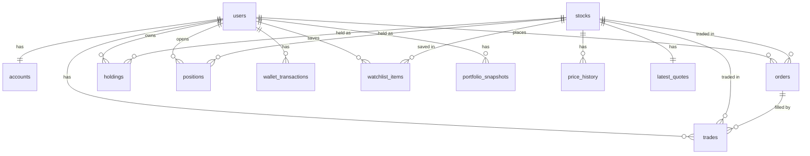

# Indian Stock Market Simulator: Architecture Blueprint

> Master reference for the AI coding agent. Build **one phase at a time** (section 14), test each before moving on. Do not add features that are not in this document without asking.

---

## 1. What we are building

A **local-only** paper-trading app for Indian stocks (NSE). Users get virtual money (default ₹10,00,000), see real (delayed) prices from yfinance, and can place **market, limit and stop-loss orders**, for both **delivery (CNC)** and **intraday (MIS)** trades, including short selling in intraday. The app shows holdings, positions, P&L, history, watchlist and market insights (gainers, losers, high return).

**Non-goals (for now):** real money, deployment, options/futures, mutual funds, brokerage fees (config flag only), mobile app.

---

## 2. Core principles (rules for the agent)

1. **Backend owns the data.** Only the backend talks to yfinance. It saves prices to the DB. The frontend only calls our own API.
2. **Price provider is one swappable module** (`providers/base.py` interface, `providers/yfinance_provider.py` implementation). Nothing else imports yfinance.
3. **Money is stored as integer paise** (₹1 = 100 paise) in the DB to avoid floating point bugs. Convert to ₹ only at the API/UI boundary. Prices are also paise.
4. **All trade execution goes through ONE function** (`execution_service.execute_order`) inside ONE DB transaction. Market, limit, stop-loss and square-off all reuse it.
5. **All timestamps stored in UTC, displayed and evaluated in IST** (`Asia/Kolkata`) for market hours.
6. **Never trust the frontend.** Re-validate balance, quantity, market hours and price on the backend for every order.
7. **Ledger is append-only.** Never edit or delete `wallet_transactions` or `trades`.
8. Every user-owned row has `user_id`. Every query filters by the logged-in user.

---

## 3. Tech stack

| Layer | Choice | Why |
|---|---|---|
| Backend | **Python + FastAPI** | Simple, fast, auto API docs at `/docs` |
| DB | **SQLite** + **SQLAlchemy 2** + **Alembic** | Zero setup, one file |
| Prices | **yfinance** (NSE symbols like `RELIANCE.NS`) | Free, no account |
| Jobs | **APScheduler** (inside the FastAPI process) | No separate services |
| Auth | Email + password, **bcrypt** hash, **JWT** in httpOnly cookie | Simple, local |
| Frontend | **React + Vite + TypeScript** | Popular, agents know it well |
| Styling | **Tailwind CSS** + **shadcn/ui** | Matches the clean card UI in the reference screenshot |
| Charts | **lightweight-charts** (TradingView) for price chart, **Recharts** for pie/line | Candlestick and line support |
| Data fetching | **TanStack Query** | Caching and auto refresh (polling) |
| Routing | **React Router** | Pages |
| Icons | **lucide-react** | |

Frontend `package.json` dependencies: `react`, `react-dom`, `react-router-dom`, `@tanstack/react-query`, `axios`, `lightweight-charts`, `recharts`, `lucide-react`, `tailwindcss`, `clsx`, `date-fns`, `zustand` (small global state). Dev: `vite`, `typescript`, `@types/react`, `eslint`.

---

## 4. Folder structure

```
stock-sim/
├─ requirements.txt
├─ architecture.md
├─ .env.example
├─ backend/
│  ├─ app/
│  │  ├─ main.py                 # FastAPI app, starts scheduler
│  │  ├─ config.py               # settings (starting cash, margin %, etc.)
│  │  ├─ db.py                   # engine, session
│  │  ├─ models/                 # SQLAlchemy tables (one file per entity)
│  │  ├─ schemas/                # Pydantic request/response models
│  │  ├─ api/                    # routers: auth, stocks, orders, portfolio, watchlist, insights, admin
│  │  ├─ services/
│  │  │  ├─ auth_service.py
│  │  │  ├─ market_clock.py      # is market open, IST helpers, holidays
│  │  │  ├─ execution_service.py # THE trade execution function
│  │  │  ├─ order_service.py     # validate + place/cancel orders
│  │  │  ├─ order_engine.py      # checks pending orders (job)
│  │  │  ├─ square_off.py        # 3:15 PM MIS auto close (job)
│  │  │  ├─ portfolio_service.py # P&L math
│  │  │  ├─ insights_service.py  # gainers, losers, high return
│  │  │  └─ snapshot_service.py  # daily portfolio value snapshot
│  │  ├─ providers/
│  │  │  ├─ base.py              # PriceProvider interface
│  │  │  ├─ yfinance_provider.py
│  │  │  └─ replay_provider.py   # plays old candles as "live"
│  │  ├─ jobs/scheduler.py       # registers all scheduled jobs
│  │  └─ seed/nifty50.csv        # symbol, name, sector
│  ├─ alembic/
│  └─ tests/
└─ frontend/
   ├─ package.json
   └─ src/ (pages/, components/, api/, hooks/, store/)
```

---

## 5. Database design

All money/price columns = **INTEGER paise**. All `created_at`/`updated_at` = UTC datetime.

### 5.1 Entity relationship



### 5.2 Tables

**users**: `id`, `name`, `email` (unique), `password_hash`, `created_at`

**accounts** (one wallet per user):
- `id`, `user_id` (unique FK)
- `cash_balance`: free cash available to use
- `starting_balance`: for return % calculation
- `realized_pnl_total`: running total of all realized P&L
- `created_at`, `updated_at`

Cash is **moved out of `cash_balance`** when blocked (pending buy orders, intraday margin). Total equity = cash + blocked amounts + holdings value + positions P&L.

**stocks** (instrument master, seeded from Nifty 50 CSV):
- `id`, `symbol` (e.g. `RELIANCE`), `yf_symbol` (`RELIANCE.NS`), `exchange` (`NSE`)
- `company_name`, `sector`, `industry`, `logo_url` (nullable)
- `market_cap`, `pe_ratio`, `dividend_yield`, `description` (filled from yfinance `info`, refreshed daily)
- `is_active`

**price_history** (candles):
- `id`, `stock_id`, `interval` (`1d` or `1m`), `ts` (candle time), `open`, `high`, `low`, `close`, `volume`
- Unique on (`stock_id`, `interval`, `ts`)
- `1d`: keep ~5 years. `1m`: keep last ~7 days only (yfinance limit), purge older.

**latest_quotes** (one row per stock, overwritten every refresh):
- `stock_id` (PK/FK), `price` (LTP), `prev_close`, `open`, `day_high`, `day_low`, `volume`
- `day_change`, `day_change_pct`, `week52_high`, `week52_low`
- `return_1m_pct`, `return_6m_pct`, `return_1y_pct` (precomputed daily from `price_history`)
- `avg_volume_20d`, `updated_at`

**orders** (intent):
- `id`, `user_id`, `stock_id`
- `side`: `BUY` | `SELL`
- `product_type`: `CNC` | `MIS`
- `order_type`: `MARKET` | `LIMIT` | `SL_M` (stop-loss market)
- `quantity`, `filled_quantity`
- `limit_price` (nullable, for LIMIT)
- `trigger_price` (nullable, for SL_M)
- `validity`: `DAY` (default) | `GTT` (stays until cancelled, CNC only, phase 2 optional)
- `status`: `PENDING` | `EXECUTED` | `CANCELLED` | `REJECTED` | `EXPIRED`
- `reject_reason` (nullable)
- `blocked_amount`: cash reserved for this pending order
- `created_at`, `executed_at`, `expires_at`

**trades** (what actually happened; append-only):
- `id`, `order_id`, `user_id`, `stock_id`
- `side`, `product_type`, `quantity`, `price`, `total_value`
- `realized_pnl` (nullable; set when the trade reduces/closes a holding or position)
- `reason`: `USER` | `LIMIT_HIT` | `SL_HIT` | `SQUARE_OFF` | `GAP_FILL`
- `executed_at`

**holdings** (delivery, CNC; one row per user+stock):
- `id`, `user_id`, `stock_id`, `quantity`, `avg_buy_price`, `updated_at`
- Unique on (`user_id`, `stock_id`). Delete row when quantity hits 0.
- Note: no T+1 settlement. Bought shares can be sold immediately (simplification).

**positions** (intraday, MIS; one row per user+stock per trading day):
- `id`, `user_id`, `stock_id`, `trade_date`
- `net_quantity`: positive = long, negative = short
- `avg_price`, `margin_blocked`, `realized_pnl`
- `is_open`, `closed_at`

**wallet_transactions** (ledger, append-only):
- `id`, `user_id`
- `type`: `INITIAL` | `BUY` | `SELL` | `MARGIN_BLOCK` | `MARGIN_RELEASE` | `ORDER_BLOCK` | `ORDER_RELEASE` | `PNL_INTRADAY` | `FEE` | `RESET`
- `amount` (signed: negative = money out of cash), `balance_after`
- `ref_order_id`, `ref_trade_id` (nullable), `note`, `created_at`

**watchlist_items**: `id`, `user_id`, `stock_id`, `created_at`. Unique on (`user_id`, `stock_id`).

**portfolio_snapshots** (one per user per trading day, written at 3:35 PM):
- `id`, `user_id`, `date`, `cash`, `holdings_value`, `invested`, `total_value`, `realized_pnl_total`

**market_holidays**: `date`, `description` (seed manually for the year; market is also closed Sat/Sun)

**app_state** (key/value, for replay mode and last-refresh info): `key`, `value`

---

## 6. Settings (`config.py` / `.env`)

| Setting | Default |
|---|---|
| `STARTING_CASH_PAISE` | 1,000,000,00 (₹10,00,000) |
| `MIS_MARGIN_PERCENT` | 20 (needs 20% of trade value, 5x leverage) |
| `FLAT_FEE_PAISE` | 0 (set to 2000 for ₹20/order later) |
| `PRICE_REFRESH_SECONDS` | 60 |
| `ORDER_ENGINE_SECONDS` | 60 |
| `MARKET_OPEN` / `MARKET_CLOSE` | 09:15 / 15:30 IST |
| `MIS_SQUARE_OFF_TIME` | 15:15 IST |
| `MIS_CUTOFF_NEW_ORDERS` | 15:15 IST (no new MIS orders after) |
| `REPLAY_MODE` | false |
| `JWT_SECRET` | random string in `.env` |

---

## 7. Price data pipeline

**PriceProvider interface** (`providers/base.py`):
- `get_quotes(symbols) -> dict` : current price, prev close, day open/high/low, volume
- `get_history(symbol, interval, period) -> candles`
- `get_company_info(symbol) -> dict` : sector, market cap, P/E, dividend yield, 52w high/low

**yfinance implementation notes**
- Always use **batch** downloads (`yf.download(list_of_symbols, ...)`), never one call per stock in a loop.
- NSE suffix `.NS`. Index for ticker/reference: `^NSEI` (Nifty 50).
- Prices are ~15 min delayed. Fine.
- Wrap every call in try/except with retries. If a refresh fails, **keep the old quote**, log it, and show a "data delayed" badge in the UI. Never crash.
- Convert rupee floats to paise integers immediately (`round(price * 100)`).

**Jobs**
| Job | When | Does |
|---|---|---|
| `refresh_quotes` | every 60s, market hours | batch fetch, update `latest_quotes`, append `1m` candles |
| `refresh_daily_history` | once at 4:00 PM IST + on first startup | update `1d` candles, recompute 52w and 1M/6M/1Y returns |
| `refresh_company_info` | once daily | update market cap, P/E, etc. |
| `order_engine` | every 60s, market hours | process PENDING orders (section 9) |
| `square_off_mis` | 3:15 PM IST Mon-Fri | close all open MIS positions |
| `expire_day_orders` | 3:30 PM IST | expire pending DAY orders, release blocks |
| `daily_snapshot` | 3:35 PM IST | write `portfolio_snapshots` |
| `purge_old_minute_candles` | daily | delete `1m` older than 7 days |

**Initial seed (first run):** load `nifty50.csv` into `stocks`, then backfill 5 years of `1d` candles and 7 days of `1m` candles, then fill `latest_quotes`.

### Replay mode
Because the market is closed nights and weekends, `replay_provider.py` takes the last N days of `1m` candles and "plays" them as if live (speed adjustable, e.g. 1 candle per 2 seconds). When `REPLAY_MODE=true`: `market_clock.is_open()` always returns true, quotes come from the replay provider, and the order engine runs on each replay tick. This is essential for testing limit, stop-loss and square-off outside market hours. Toggle it from the Settings page (dev only).

---

## 8. Order and trade logic

### 8.1 Validation (before any order is accepted)
1. Stock exists and is active.
2. Market is open (or replay mode). Otherwise reject with a clear message ("Market closed").
3. `quantity` is a positive integer.
4. MIS orders rejected after 15:15 IST.
5. Type-specific fields: LIMIT needs `limit_price`, SL_M needs `trigger_price`.
6. Sanity: limit/trigger price within ±20% of current price (circuit-limit-like guard).
7. Funds / holdings check (below).

### 8.2 Funds and holdings checks

| Case | Check | Blocked on placement |
|---|---|---|
| CNC BUY | `cash ≥ qty × price` (limit price for LIMIT, current price for MARKET) | full amount (for pending orders) |
| CNC SELL | `holding.qty − qty already in pending sell orders ≥ qty` | none (shares are "reserved" by the pending-qty check) |
| MIS BUY or SELL (opening or increasing) | `cash ≥ MIS_MARGIN_PERCENT% × qty × price` | margin amount |
| MIS order that only reduces/closes an existing position | no extra cash needed | none |

Short selling is **allowed only in MIS**. A CNC SELL with no holding is rejected.

### 8.3 Order types

- **MARKET**: executes immediately at the latest price.
- **LIMIT**:
  - BUY fills when `price ≤ limit_price`
  - SELL fills when `price ≥ limit_price`
  - If already satisfied on placement, fill immediately at the current price (better-than-limit fill).
  - Otherwise: status `PENDING`, block funds.
- **SL_M** (stop-loss, market on trigger):
  - Typically a protective **SELL**: triggers when `price ≤ trigger_price`
  - Also supports BUY stop (covering a short): triggers when `price ≥ trigger_price`
  - Always `PENDING` on placement. Trigger must be on the correct side of the current price (SELL: below it, BUY: above it), otherwise reject.
  - On trigger, executes as a market order.

### 8.4 `execute_order(order, fill_price, reason)`: the single execution function
Runs in **one DB transaction**. If anything fails, everything rolls back.

**CNC BUY**
1. Release any `blocked_amount` back to cash (ledger `ORDER_RELEASE`).
2. Deduct `qty × fill_price` from cash (ledger `BUY`).
3. Upsert holding: `new_avg = (old_qty × old_avg + qty × fill_price) / (old_qty + qty)` (round to paise).
4. Insert `trade`, set order `EXECUTED`, `filled_quantity`, `executed_at`.

**CNC SELL**
1. Add `qty × fill_price` to cash (ledger `SELL`).
2. `realized_pnl = (fill_price − avg_buy_price) × qty`. Add to `accounts.realized_pnl_total`.
3. Reduce holding qty (delete row at 0). Average buy price does **not** change on sells.
4. Insert `trade` (with `realized_pnl`), set order `EXECUTED`.

**MIS (BUY or SELL)** : operates on `positions` (net quantity, signed: BUY = +qty, SELL = −qty)
1. Load or create today's open position for the stock.
2. Split the order into a **closing part** (the portion that reduces the existing opposite quantity) and an **opening part** (the portion that adds to or flips the position).
3. Closing part: `realized_pnl = (fill_price − avg_price) × closed_qty` for longs, `(avg_price − fill_price) × closed_qty` for shorts. Credit/debit P&L to cash (ledger `PNL_INTRADAY`). Release proportional margin (ledger `MARGIN_RELEASE`).
4. Opening part: update weighted `avg_price`, block extra margin = `MIS_MARGIN_PERCENT% × opening_qty × fill_price` (ledger `MARGIN_BLOCK`).
5. Update `net_quantity`. If it reaches 0, `is_open = false`, `closed_at = now`.
6. Insert `trade`, set order `EXECUTED`.
7. Margin accounting: cash is reduced when margin is blocked and increased when released. Realized P&L is added to or taken from cash when positions close.

**Fees:** if `FLAT_FEE_PAISE > 0`, deduct per executed order (ledger `FEE`).

### 8.5 Order engine (runs every 60s in market hours)
For each PENDING order:
1. Expire it if past `expires_at`.
2. Fetch the **1m candles since this order's last check** (`high`, `low`, `open`). Using candle high/low means a brief touch between runs is not missed.
3. Conditions:
   - LIMIT BUY: candle `low ≤ limit_price` → fill
   - LIMIT SELL: candle `high ≥ limit_price` → fill
   - SL_M SELL: candle `low ≤ trigger_price` → trigger
   - SL_M BUY: candle `high ≥ trigger_price` → trigger
4. **Fill price rules:**
   - LIMIT: fill at `limit_price`, unless the candle opened better than the limit (then fill at open).
   - SL_M: fill at `trigger_price`, unless the stock **gapped** through it (candle open already beyond trigger) → fill at the **open price** (`reason = GAP_FILL`). This is realistic and teaches the lesson.
5. Call `execute_order`. If execution fails (e.g. insufficient funds because of other activity), set `REJECTED` with `reject_reason` and release blocks.
6. A candle processed twice must not fill an order twice. Check status inside the transaction (idempotent).

### 8.6 Auto square-off (3:15 PM)
For every open MIS position: create a system MARKET order (opposite side, `reason = SQUARE_OFF`) at the latest price and run `execute_order`. Also cancel all pending MIS orders and release their blocks. Mark in UI as "Auto square-off".

### 8.7 Cancel order
Only PENDING orders. Release `blocked_amount` (ledger `ORDER_RELEASE`), status `CANCELLED`.

### 8.8 Reset account
Deletes the user's orders, trades, holdings, positions, wallet transactions and snapshots, resets cash to starting balance and writes an `INITIAL`/`RESET` ledger entry. Requires a confirm dialog.

---

## 9. Portfolio math (`portfolio_service.py`)

- **Invested** = Σ(holding.qty × avg_buy_price)
- **Current value** = Σ(holding.qty × latest price)
- **Unrealized P&L** (holdings) = current − invested, and % = P&L / invested
- **Day's P&L** = Σ(qty × day_change) for holdings
- **Intraday unrealized** = Σ over open positions: `(price − avg_price) × net_qty` (works for shorts since qty is negative)
- **Realized P&L** = `accounts.realized_pnl_total` (all-time), also filterable by date from `trades`
- **Total P&L** = realized + unrealized (holdings + positions)
- **Total equity** = free cash + blocked order amounts + margin blocked + holdings value + intraday unrealized P&L
- **Overall return %** = (total equity − starting_balance) / starting_balance
- **Allocation by sector** = group holdings value by `stocks.sector`

---

## 10. Insights (`insights_service.py`)

No extra tables; computed from `latest_quotes` and `price_history`:

| Insight | Rule |
|---|---|
| Top gainers / losers (today) | sort by `day_change_pct` |
| Near 52-week high / low | price within 3% of `week52_high` / `week52_low` |
| High return | sort by `return_1m_pct`, `return_6m_pct` or `return_1y_pct` |
| Volume spike | `volume > 2 × avg_volume_20d` |
| Trend label (rising / declining / sideways) | compare price to 50-day and 200-day moving average: above both = Rising, below both = Declining, else Sideways |
| Sector performance | average `day_change_pct` per sector |

Show a disclaimer on every insights view: **"Based on past performance. Not investment advice."**

---

## 11. API endpoints (REST, all under `/api`)

**Auth**
- `POST /auth/signup`, `POST /auth/login`, `POST /auth/logout`, `GET /auth/me`

**Stocks**
- `GET /stocks?search=&sector=&sort=&page=` : list with latest quote
- `GET /stocks/{symbol}` : details (info + quote)
- `GET /stocks/{symbol}/history?interval=1m|1d&range=1D|1W|1M|3M|6M|1Y|5Y` : candles
- `GET /stocks/compare?symbols=TCS,INFY` : side-by-side data
- `GET /market/status` : open/closed, next open time, data last updated, replay on/off
- `GET /market/ticker` : strip of top stocks and indices

**Orders**
- `POST /orders` : place order (body: symbol, side, product_type, order_type, quantity, limit_price?, trigger_price?)
- `GET /orders?status=&date=` : list
- `DELETE /orders/{id}` : cancel

**Portfolio**
- `GET /portfolio/summary` : totals, P&L cards, equity
- `GET /portfolio/holdings`
- `GET /portfolio/positions`
- `GET /portfolio/trades?from=&to=&symbol=`
- `GET /portfolio/pnl?from=&to=` : realized P&L breakdown
- `GET /portfolio/history` : snapshots for value-over-time chart
- `GET /portfolio/allocation` : sector split
- `GET /wallet/transactions`

**Watchlist**
- `GET /watchlist`, `POST /watchlist/{symbol}`, `DELETE /watchlist/{symbol}`

**Insights**
- `GET /insights/gainers`, `/losers`, `/high-return?period=`, `/near-52w`, `/volume-spikes`, `/sectors`

**Admin / dev**
- `POST /admin/replay/start`, `/stop`, `/speed`
- `POST /account/reset`

Frontend polls `/market/ticker`, `/stocks/{symbol}` and `/portfolio/summary` every ~30-60s via TanStack Query (no websockets needed).

---

## 12. UI: pages and contents

**Global layout** (as in the reference screenshot): left icon sidebar (Dashboard, Stocks, Portfolio, Orders, Watchlist, Insights, Settings), top bar (breadcrumb, search with autocomplete, market status pill "Market Open / Closed / Replay", wallet balance, user avatar), and a **scrolling ticker strip** with top stocks and Nifty 50.

### 1. Login / Sign up
Email, password, name (signup). Starting cash shown ("You'll start with ₹10,00,000").

### 2. Dashboard
- Summary cards: Total equity, Day's P&L, Total P&L, Available cash
- Portfolio value over time chart (from snapshots)
- Top gainers and top losers (5 each)
- Top holdings mini-list
- Open intraday positions (with live P&L and a "Square off" button)
- Pending orders count with link

### 3. Stocks (screener)
- Search box, sector filter, sort (name, price, change %, market cap, volume)
- Table: logo, name, symbol, price, day change %, volume, market cap, 1M/1Y return, mini sparkline, watchlist star
- Tabs for quick lists: All, Gainers, Losers, 52W High, High Return, Volume Spikes
- Click a row → stock detail

### 4. Stock detail (the page in the reference image)
- **Header**: logo, name, symbol, sector, current price, change and %, **Watchlist** button, **Buy** and **Sell** buttons
- **4 stat cards**: Market Cap, Volume, Day High/Low, 52-Week High/Low (with trend arrows)
- **Price chart**: timeframe buttons (1D, 1W, 1M, 3M, 6M, 1Y, 5Y), line/candlestick toggle
- **Details panel** (right): company, ticker, sector, current price, change, market cap, volume, P/E, dividend yield, 52W high/low, trend label, short description
- **Order ticket** (opens as a drawer or modal from Buy/Sell):
  - Tabs: BUY / SELL (colored)
  - Product: Delivery (CNC) / Intraday (MIS)
  - Order type: Market / Limit / Stop-loss
  - Quantity, Price (for limit), Trigger price (for stop-loss)
  - Live summary: required amount or margin, available cash, estimated charges
  - Warnings: "Market closed", "Insufficient funds", "Short selling only allowed in Intraday"
  - Submit button, and clear success/error toast
- **Your position in this stock** card: quantity, avg price, P&L
- **Stock comparison** section: pick stocks to compare performance (cards like the reference bottom section, with a "See all" link)

### 5. Portfolio
Tabs:
- **Holdings** (delivery): table with stock, qty, avg price, LTP, invested, current value, day P&L, total P&L and %, with Buy more / Sell buttons. Top cards: Invested, Current value, Unrealized P&L, Day's P&L.
- **Positions** (intraday): symbol, net qty, avg price, LTP, P&L, margin used, "Square off" button
- **P&L report**: realized P&L total, filter by date range, per-stock realized P&L table, win rate
- **History**: all trades (date, stock, side, product, qty, price, value, realized P&L, reason) with filters and CSV export
- **Allocation**: sector pie chart
- Portfolio value over time line chart

### 6. Orders
- Tabs: **Pending**, **Executed**, **Cancelled/Rejected**, **All**
- Columns: time, stock, side, product, type, qty, limit/trigger price, status, reject reason
- Pending orders have **Cancel** (and optional Modify) actions
- Badge showing why an order filled ("Limit hit", "Stop-loss hit", "Gap fill", "Auto square-off")

### 7. Watchlist
Table of saved stocks with live price, change %, quick Buy/Sell buttons and remove.

### 8. Insights
Cards/tabs: Top gainers, Top losers, High return (1M/6M/1Y toggle), Near 52-week high/low, Volume spikes, Trend labels (Rising/Declining/Sideways), Sector performance heatmap. Disclaimer shown.

### 9. Settings
Profile, **Reset account** (confirm dialog), theme (light/dark), **Replay mode** controls (dev), data source status and last refresh time.

**UI states every page needs:** loading skeletons, empty states ("No holdings yet. Buy your first stock"), error banners ("Prices delayed, showing last known data"), and Indian number formatting (`₹1,23,456.78`, lakh/crore units for market cap).

---

## 13. Edge cases the agent must handle

- Market closed, weekends, NSE holidays, replay mode
- yfinance failure or missing data: keep last quote, show badge
- Order double-processing: make the engine idempotent
- Pending sell orders exceeding holdings
- Stock gaps through a stop-loss: fill at open
- Fractional quantities not allowed (whole shares only)
- Cash going negative: never allowed, enforce in DB transaction
- Money must always reconcile: `cash + blocks + holdings + positions` consistent with the ledger (write a test for this)
- Server restart mid-day: scheduler resumes, pending orders remain, engine catches up using candles since the order's last check
- Server was off during square-off time: on startup, close stale open MIS positions from previous days at the last known price

---

## 14. Build phases (do in order, test each)

1. **Foundation**: project setup, config, DB models, Alembic migration, seed Nifty 50 stocks
2. **Price pipeline**: provider interface, yfinance provider, backfill history, `latest_quotes` refresh job, market clock
3. **Auth**: signup, login, wallet creation with starting cash
4. **Stocks UI**: layout, ticker strip, stock list, stock detail with chart and details panel
5. **Market orders (CNC)**: execution service, order ticket, holdings update, ledger, tests
6. **Portfolio**: holdings, P&L cards, trade history, orders page
7. **Insights + Dashboard**: gainers/losers/high return, dashboard cards
8. **Replay mode**: so testing is possible any time
9. **Limit and stop-loss (CNC)**: pending orders, blocked funds, order engine, cancel, expiry, gap fills
10. **Intraday (MIS)**: positions table, margin, short selling, 3:15 PM square-off
11. **Polish**: watchlist, comparison, allocation chart, portfolio snapshots chart, reset account, empty/error states

**Testing priorities (pytest):** average price math, realized P&L (long and short), margin block/release, limit/SL trigger conditions, gap fill price, insufficient funds, cancel releases funds, square-off, and the money-reconciliation check.

---

## 15. Suggested prompt style for the agent

"Read `architecture.md`. Build **Phase N only**. Follow the core principles in section 2. When done, write tests, run them, and tell me how to run and check it manually. Do not start the next phase."
